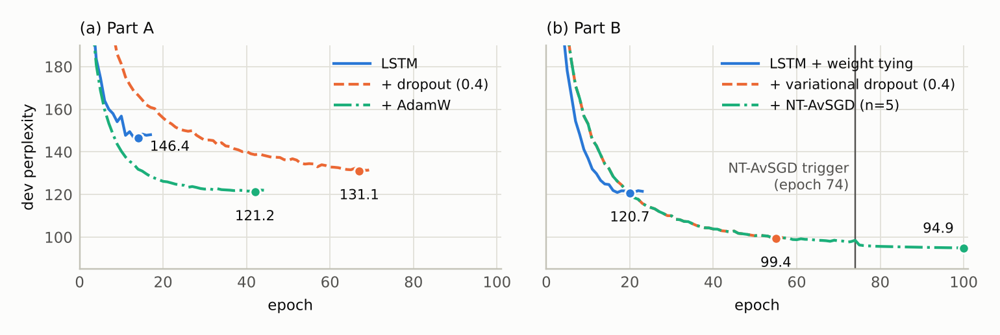

<h1 align="center">Can We Trust an Ablation Study?</h1>

<p align="center">
  <b>Silent errors and seed variance in two incremental NLP studies: LSTM language models on the Penn Treebank and joint intent classification and slot filling on ATIS</b><br>
  Natural Language Understanding · University of Trento
</p>

<p align="center">
  <a href="paper/trusting_ablations.pdf"></a>
  <a href="https://colab.research.google.com/github/giampyhatesyou/Natural_Language_Processing/blob/main/run_on_colab.ipynb"></a>
  <a href="https://github.com/giampyhatesyou/Natural_Language_Processing/actions/workflows/ci.yml"></a>
  
  
  
</p>

<p align="center">
  <picture>
    <source media="(prefers-color-scheme: dark)" srcset="assets/effects_dark.png">
    
  </picture>
</p>

**TL;DR.** I audited the original implementation of two incremental ablation studies and compared the effects it
reported with those of a re-implementation verified by tests. Seven of the ten step-wise effects change: two
reverse sign, three are off by more than a factor of two, and the two gains of dropout on ATIS are within the
variation between seeds. None of the errors behind them raised an exception or produced an implausible number.
Put back into the code one at a time, all of them are caught by a test suite that runs in 45 seconds on a CPU.

## Key results

- **7 of 10 conclusions change.** NT-AvSGD and BERT on slot filling reverse sign; the language-model gain of dropout
  is 3.8× overstated, the one of AdamW 16× understated, the intent gain of the BiLSTM 2.1× overstated; dropout on
  ATIS is not significant (p = 0.10 on slot F1, p = 0.06 on intent accuracy).
- **A confound inside an ablation.** Of the 4.5 dev-perplexity points that NT-AvSGD gains over variational dropout,
  1.8 come from the longer training its stopping rule allows and 2.7 from the averaging itself.
- **Selection is not measurement.** The BERT run with the best dev F1, the one kept as checkpoint, is the worst of
  the five on the test set.
- **16 of 16 mutants killed.** The audited errors and three plausible variants, re-introduced one at a time, all
  make a test fail.

## The question

An ablation study adds one component at a time and credits the change in a metric to that component. Its
conclusions rest on two assumptions: the code does what the paper says, and the differences exceed the variation
between runs. The second assumption has a literature on score distributions and significance testing; the first
is hard to study, because implementation errors are invisible once the numbers are published.

Here both versions of the same study exist: the original implementation, which was my final project for the
Natural Language Understanding course (2025), and an audited re-implementation with the same tasks, models and
steps. So the question can be asked directly: how much did the errors change the conclusions, which effects
survive the variation between seeds, and which checks would have caught the errors?

## How it works

**Two case studies, one step at a time.**

| | Language modelling | Intent classification and slot filling |
| - | - | - |
| Data | Penn Treebank, 10k-word vocabulary | ATIS: 4,978 training and 893 test utterances, 26 intents, 129 slot labels |
| Steps | LSTM → + dropout → + AdamW; LSTM + weight tying → + variational dropout → + NT-AvSGD | LSTM → BiLSTM → + dropout → BERT |
| Metric | perplexity | chunk-level slot F1 (conlleval) and intent accuracy |
| Runs | 1 per configuration | 5 seeds, Welch's t-test and 95% confidence intervals |

**Protocol.** Each step changes one factor, and a test compares the configurations of consecutive steps key by
key. Model selection uses the dev set only, the weights of the best dev epoch are restored, and the test set is
evaluated once per run.

**Audit.** [`AUDIT.md`](AUDIT.md) lists every error of the original implementation, its effect on the reported
study and the test that now catches it; the numbers the original study reported are in
[`results/original_study.json`](results/original_study.json). Each step is then classified with a fixed rule:
*not significant* if the audited difference is not significant, otherwise *sign reversed* if the signs differ,
*overstated* or *understated* if the two effects differ by more than a factor of two, *confirmed* otherwise.

**Verification.** The tests combine five kinds of checks:

- **oracle evaluation:** a model that returns the gold labels must score exactly 1.0;
- **tests from the definition:** the NT-AvSGD trigger on a synthetic trace, its running mean, the variational
  dropout mask;
- **invariance:** trained with a learning rate of 0, BERT must save exactly its pre-trained encoder;
- **protocol:** one change per step, and the best dev epoch left in the model;
- **end-to-end:** train, save, reload and reproduce the recorded scores.

[`scripts/mutation_test.py`](scripts/mutation_test.py) then measures the tests themselves.

## Results

### What the audit changed

| Step | Metric | Original | Audited | p | Outcome |
| - | - | - | - | - | - |
| + dropout | PPL | +57.6 | +15.2 | – | 3.8× overstated |
| + AdamW | PPL | +1.1 | +17.0 | – | 16× understated |
| + variational dropout | PPL | +22.2 | +19.5 | – | confirmed |
| + NT-AvSGD | PPL | -0.2 | +5.1 | – | sign reversed |
| BiLSTM | slot F1 | +1.34 | +1.89 | < 0.001 | confirmed |
| BiLSTM | intent acc. | +2.35 | +1.10 | 0.005 | 2.1× overstated |
| + dropout | slot F1 | +0.42 | +0.46 | 0.099 | not significant |
| + dropout | intent acc. | -0.34 | +0.40 | 0.059 | not significant |
| BERT | slot F1 | -5.32 | +0.90 | 0.001 | sign reversed |
| BERT | intent acc. | +1.94 | +2.60 | < 0.001 | confirmed |

Reduction of the test perplexity, or gain in points of slot F1 and intent accuracy; positive means the step helps.
Weight tying is left out because in both studies its baseline is trained with other hyperparameters. The two
implementations also differ in some hyperparameters, so the table measures the combined effect of the fixes and of
those changes; the paper attributes a change to an error only when the mechanism is direct.

The errors were ordinary and silent. The "LSTM" baseline was an `nn.RNN`, and the dropout model also tied its
weights, so dropout was credited with two techniques and a weaker baseline. The NT-AvSGD trigger ignored its
non-monotone interval, and the tested weights were not the ones selected on dev. The dropout before the intent
layer was applied after the intent logits. The BERT code was never committed, and its 89.0 slot F1 is what a
randomly initialised BERT reaches with the audited pipeline (88.7). Two of these results were explained away in
the original report, NT-AvSGD as sensitivity to hyperparameters and BERT as noise introduced by WordPiece.

### Audited results

**Language modelling** (Penn Treebank, perplexity, one run per configuration):

| Part | Model | Dev PPL | Test PPL |
| - | - | - | - |
| A | LSTM | 146.4 | 141.3 |
| A | + dropout (0.4) | 131.1 | 126.0 |
| A | + AdamW | 121.2 | **109.0** |
| B | LSTM + weight tying | 120.7 | 116.9 |
| B | + variational dropout (0.4) | 99.4 | 97.4 |
| B | + NT-AvSGD (n = 5) | 94.9 | **92.3** |

**Intent classification and slot filling** (ATIS test set, mean ± sample standard deviation over 5 seeds; p is
Welch's t-test against the previous row):

| Model | Slot F1 | p | Intent accuracy (%) | p |
| - | - | - | - | - |
| LSTM | 92.24 ± 0.54 | – | 93.44 ± 0.47 | – |
| BiLSTM | 94.13 ± 0.45 | < 0.001 | 94.54 ± 0.15 | 0.005 |
| BiLSTM + dropout | 94.59 ± 0.30 | 0.099 | 94.94 ± 0.35 | 0.059 |
| BERT (`bert-base-uncased`) | **95.49 ± 0.11** | 0.001 | **97.54 ± 0.24** | < 0.001 |

<details>
<summary>Dev perplexity of the language models after every epoch</summary>
<br>
<picture>
  <source media="(prefers-color-scheme: dark)" srcset="assets/lm_dev_ppl_dark.png">
  
</picture>
</details>

Every table and figure is generated from the JSON records in [`results/`](results) by
[`paper/analysis.py`](paper/analysis.py).

## What I take away from it

- **A plausible explanation of an implausible result is where an audit should start.** NT-AvSGD and BERT both had
  convincing stories, and both were bugs.
- **Test the evaluation, not only the model.** An oracle that returns the gold labels must score exactly 1.0; it is
  the cheapest way to trust a metric.
- **An ablation changes one factor at a time, and a diff can check it.** Two of the ten steps of the original study
  changed two factors.
- **Implement the algorithm from its definition, then test the definition.** The first NT-AvSGD looked reasonable
  and differed from the paper in its trigger, its average and its selection.
- **Report variance and test significance.** One of the three ATIS steps, dropout, is within the noise between
  seeds.
- **Select on dev, report the mean.** The run kept as checkpoint is not a measurement of the model.
- **Test the tests.** Mutation analysis found two holes in my own suite after I believed it was complete.

## Limitations & next steps

- **One study, one author.** I also wrote the original implementation, so the audit is not independent, and the
  errors listed are the ones the tests can see.
- **Two moving parts.** The implementations differ in some hyperparameters as well as in their errors, so the
  changes of the conclusions combine the two.
- **One seed for the language models.** Their effects have no confidence interval. Next: three seeds per
  configuration (`--runs 3`), about five and a half hours on a T4.
- **Known errors only.** Killing 16 mutants shows that the suite guards against these errors, not against unknown
  ones. Next: apply the same checklist to a study I did not write.

## Run it

```bash
git clone https://github.com/giampyhatesyou/Natural_Language_Processing.git
cd Natural_Language_Processing
pip install -e ".[dev]"    # Python 3.10 or later
```

```bash
python -m nlp.lm --train                    # train the six language models
python -m nlp.slu --train --exp bert        # or some experiments, here BERT (5 seeds)
python -m nlp.lm                            # evaluate the checkpoints on the test set
python paper/analysis.py                    # tables and figures, from the JSON records
pytest                                      # the test suite, about 45 seconds on a CPU
python scripts/mutation_test.py             # mutation analysis of the test suite, about 3 minutes
```

The two commands are also installed as `nlp-lm` and `nlp-slu`, and `--help` lists their options. The
hyperparameters of every experiment are in a registry at the top of [`nlp/lm/cli.py`](nlp/lm/cli.py) and
[`nlp/slu/cli.py`](nlp/slu/cli.py). Every training writes a JSON record per experiment in `results/<task>/`, the
loss curves in `results/plots/` and the checkpoint of the run with the best dev score in `checkpoints/` (not in git
because of its size). Seeds are fixed, so a re-run gives the same results up to the nondeterminism of GPU kernels.

On a GPU, [`run_on_colab.ipynb`](run_on_colab.ipynb) trains everything, saves checkpoints and results to Google
Drive after each group of experiments and evaluates the checkpoints; on a free T4 the whole study takes about
2 hours and 20 minutes. The records in `results/` come from such a run (October 2026), made before the JSON records
existed: [`scripts/logs_to_results.py`](scripts/logs_to_results.py) converted its logs, kept in
[`results/logs`](results/logs), and checked that the hyperparameters they print are the ones of the registries.

To rebuild the paper: `cd paper && pdflatex trusting_ablations && bibtex trusting_ablations && pdflatex
trusting_ablations && pdflatex trusting_ablations`.

## Repository structure

```
├── nlp/                     the Python package
│   ├── common.py            seeding, initialisation, early stopping, checkpoints, statistics, plots
│   ├── results.py           JSON record of an experiment
│   ├── lm/                  language modelling: data, model, NT-AvSGD, training loop, command line
│   └── slu/                 intent classification and slot filling: data for the LSTMs and for BERT, models,
│                            conlleval, training loop, command line
├── data/                    Penn Treebank and ATIS
├── results/
│   ├── lm/, slu/            JSON record of every experiment
│   ├── original_study.json  the numbers reported by the original implementation
│   ├── plots/               loss curves of the selected runs
│   └── logs/                training logs of the GPU run
├── paper/                   the paper (PDF and LaTeX), analysis.py, generated tables and figures
├── assets/                  README figures, in light and dark versions
├── scripts/                 mutation analysis; conversion of the logs into JSON records
├── tests/                   unit, regression, invariance and end-to-end tests
├── AUDIT.md                 every error of the original implementation, its effect and its test
├── run_on_colab.ipynb       training and evaluation on a Colab GPU
└── pyproject.toml           package metadata, dependencies, ruff and pytest configuration
```

## About this project

The two studies began as my final project for the Natural Language Understanding course at the University of
Trento (a.y. 2024/25). In 2026 I audited that implementation, rewrote it as a tested package and turned the
comparison between the two into this study. The original implementation is preserved in the git history.

Andrea Giampietro

## License

The code is released under the [MIT license](LICENSE), with one exception: `nlp/slu/conll.py`, a Python port of
the conlleval script distributed with the course material. The Penn Treebank and ATIS data in `data/` are not
covered by the license either: they derive from corpora of the Linguistic Data Consortium, and the preprocessed
copies are the ones distributed with the course material.

## References

- Reimers and Gurevych. *Reporting Score Distributions Makes a Difference: Performance Study of LSTM-networks for
  Sequence Tagging*. EMNLP 2017.
- Dror et al. *The Hitchhiker's Guide to Testing Statistical Significance in Natural Language Processing*. ACL 2018.
- Lipton and Steinhardt. *Troubling Trends in Machine Learning Scholarship*. ACM Queue 2019.
- Jia and Harman. *An Analysis and Survey of the Development of Mutation Testing*. IEEE TSE 2011.
- Merity, Keskar and Socher. *Regularizing and Optimizing LSTM Language Models*. ICLR 2018.
- Chen, Zhuo and Wang. *BERT for Joint Intent Classification and Slot Filling*. arXiv 2019.
