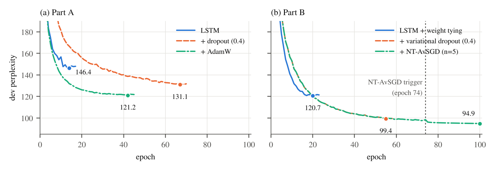

# Natural Language Understanding: language modelling and joint intent/slot filling

[](https://github.com/giampyhatesyou/Natural_Language_Processing/actions/workflows/ci.yml)
[](https://colab.research.google.com/github/giampyhatesyou/Natural_Language_Processing/blob/main/run_on_colab.ipynb)

Two classic NLU problems studied with an incremental protocol: every technique is added on top of the best model of
the previous step and evaluated on held-out data.

- **Language modelling on the Penn Treebank.** LSTM → dropout → AdamW, then the AWD-LSTM recipe: weight tying →
  variational dropout → NT-AvSGD. Test perplexity goes from 141.3 to 92.3.
- **Intent classification and slot filling on ATIS.** LSTM → BiLSTM → dropout → fine-tuned BERT. Slot F1 goes from
  92.2 to 95.5 and intent accuracy from 93.4% to 97.5% (means over 5 runs).

The project started as the final assignment of the NLU course at the University of Trento. A later review of that
first version found errors that changed the meaning of several experiments; the code was rewritten and verified,
and the review is documented in the [post-mortem](POST_MORTEM.md). Methods and results are described in two short
papers: [language modelling](language_modeling/LM_Report.pdf) and
[intent classification and slot filling](intent_slot_filling/NLU_Report.pdf).

## Results

### Language modelling (Penn Treebank, perplexity, lower is better)

| Part | Model | Dev PPL | Test PPL |
| - | - | - | - |
| A | LSTM | 146.4 | 141.3 |
| A | + dropout | 131.1 | 126.0 |
| A | + AdamW | 121.2 | **109.0** |
| B | LSTM + weight tying | 120.7 | 116.9 |
| B | + variational dropout | 99.4 | 97.4 |
| B | + NT-AvSGD | 94.9 | **92.3** |



Every technique lowers the perplexity, and part B, trained with plain SGD as NT-AvSGD requires, ends well below the
AdamW model of part A. The curves show where the NT-AvSGD gain comes from: without early stopping before the
trigger, SGD keeps improving after epoch 58, where the run without NT-AvSGD stopped, and reaches 97.6 dev PPL;
averaging, triggered at epoch 74, brings it to 94.9 and is still improving at the 100-epoch limit. Of the 4.5 dev
points gained over variational dropout, 1.8 come from the longer training and 2.7 from the averaging. Each
configuration was trained once, so these numbers carry no estimate of the variance across seeds.

### Intent classification and slot filling (ATIS test set, 5 runs)

| Model | Slot F1 | p | Intent accuracy (%) | p |
| - | - | - | - | - |
| LSTM | 92.24 ± 0.54 | – | 93.44 ± 0.47 | – |
| BiLSTM | 94.13 ± 0.45 | < 0.001 | 94.54 ± 0.15 | 0.005 |
| BiLSTM + dropout | 94.59 ± 0.30 | 0.099 | 94.94 ± 0.35 | 0.059 |
| BERT (`bert-base-uncased`) | **95.49 ± 0.11** | 0.001 | **97.54 ± 0.24** | < 0.001 |

Mean ± sample standard deviation over 5 seeds; p is Welch's t-test against the previous row. The bidirectional
encoder and BERT bring significant gains on both tasks; the gain of dropout is within the variation between seeds.
BERT is the best model on both tasks, by a wide margin on intents. `python main.py` evaluates the checkpoint kept
in `bin/`, the run with the best dev slot F1.

## Methodology

- **Incremental protocol.** Within each part, every experiment adds one technique to the best model of the previous
  one, so each row of the tables is an ablation of the row below it.
- **Data.** Penn Treebank in the preprocessed version of Mikolov et al. (42,068 / 3,370 / 3,761 sentences, 10k-word
  vocabulary). ATIS with 4,978 training and 893 test utterances, 26 intents and 129 slot labels; 10% of the
  training set, stratified by intent, is held out as dev set.
- **Model selection.** Early stopping looks only at the dev set (perplexity for the language models, slot F1 for
  the NLU models). The weights of the best dev epoch are restored, and the test set is evaluated once per run.
- **Metrics.** Perplexity is the exponential of the mean cross-entropy over all the predicted tokens, `<eos>`
  included and padding excluded. Slot F1 is the chunk-level F1 of conlleval on the original words: for BERT, the
  prediction of a word is the one of its first WordPiece sub-token, so all the models are scored on the same units.
- **Variance and significance.** Every NLU model is trained 5 times with different seeds; tables report mean and
  sample standard deviation, and consecutive models are compared with Welch's t-test (α = 0.05).
- **Verification.** The algorithms and the evaluation code have their own tests (see below), including an oracle
  check: a model that returns the gold labels must score exactly 1.0.

## Reproducibility

```bash
pip install -r requirements.txt
cd intent_slot_filling/part_A
python main.py --train                        # train every experiment of this part (checkpoints in bin/)
python main.py --train --exp bilstm_dropout   # or a single one
python main.py                                # evaluate the checkpoints in bin/ on the test set
```

The four parts work the same way, can be launched from any directory and keep their hyperparameters at the top of
`main.py`. Seeds are fixed (42 plus the run index), so a re-run gives the same results up to the nondeterminism of
GPU kernels.

On a GPU, [`run_on_colab.ipynb`](run_on_colab.ipynb) clones the repository, trains every part, copies checkpoints,
plots and logs to Google Drive after each part, and evaluates the checkpoints. On a free Colab T4 the whole run
takes about 2 hours and 20 minutes: 48 minutes for language modelling part A, 63 for part B, 8 for the LSTM
intent/slot models and 20 for BERT.

The logs of that run are in [`results/logs`](results/logs) and the loss curves of every experiment in the `plots/`
folder of each part. `python reports/analysis.py` rebuilds the perplexity figure and the significance table from
the logs. Model weights are not stored in git because of their size.

```bash
pip install pytest ruff
ruff check .    # lint
pytest          # unit and regression tests, about a minute on CPU
```

## Limitations

- The language models were trained with a single seed, so their results have no variance estimate.
- Hyperparameters were not searched systematically: they come from the first version of the project and are shared
  by all the steps of a part.
- Part B uses a smaller batch and learning rate than part A, so the comparison between the LSTM of part A and the
  tied LSTM of part B is not a controlled one.
- NT-AvSGD hit the 100-epoch limit while still improving, and part of its gain comes from the longer training that
  its stopping rule allows.
- Penn Treebank and ATIS derive from corpora of the Linguistic Data Consortium; the preprocessed copies in this
  repository are the ones distributed with the course material.

## What I learned

- **Test the evaluation, not only the model.** An oracle that returns the gold labels must score exactly 1.0; it is
  the cheapest way to trust a metric.
- **Code that runs can still be dead.** A dropout applied after the logits never raised an error and never had an
  effect; only following the data flow, or a regression test, reveals it.
- **An ablation changes one factor at a time.** In the first version the "dropout" model also had weight tying and
  the AdamW run used the model without dropout, so neither row measured what its name said.
- **Implement the algorithm from its definition, then test the definition.** The first NT-AvSGD compared the dev
  perplexity with the wrong window and averaged the wrong weights.
- **Report variance and test significance.** Of the three steps of the intent/slot experiments, one (dropout) is
  within the noise between seeds.
- **Select on dev, report the mean.** The BERT run with the best dev F1 is the worst of the five on the test set.

## Repository structure

```
├── language_modeling/
│   ├── dataset/          Penn Treebank (train / valid / test)
│   ├── part_A/           LSTM, dropout, AdamW
│   ├── part_B/           weight tying, variational dropout, NT-AvSGD
│   └── LM_Report.pdf
├── intent_slot_filling/
│   ├── part_A/           LSTM / BiLSTM joint model, ATIS data, CoNLL evaluation script
│   ├── part_B/           JointBERT
│   └── NLU_Report.pdf
├── reports/              LaTeX sources of the papers, analysis script, generated figure and table
├── results/logs/         training logs of the Colab run
├── tests/                unit and regression tests
├── run_on_colab.ipynb
└── POST_MORTEM.md        review of the first version
```

Each part is self-contained: `main.py` (entry point), `model.py` (architectures), `functions.py` (training and
evaluation) and `utils.py` (data loading and preprocessing). To rebuild a paper:
`cd reports && pdflatex lm_report && bibtex lm_report && pdflatex lm_report && pdflatex lm_report` (the same for
`nlu_report`).

## References

- Merity, Keskar and Socher. Regularizing and Optimizing LSTM Language Models. ICLR 2018.
- Gal and Ghahramani. A Theoretically Grounded Application of Dropout in Recurrent Neural Networks. NeurIPS 2016.
- Chen, Zhuo and Wang. BERT for Joint Intent Classification and Slot Filling. arXiv 2019.
- Devlin et al. BERT: Pre-training of Deep Bidirectional Transformers for Language Understanding. NAACL 2019.
